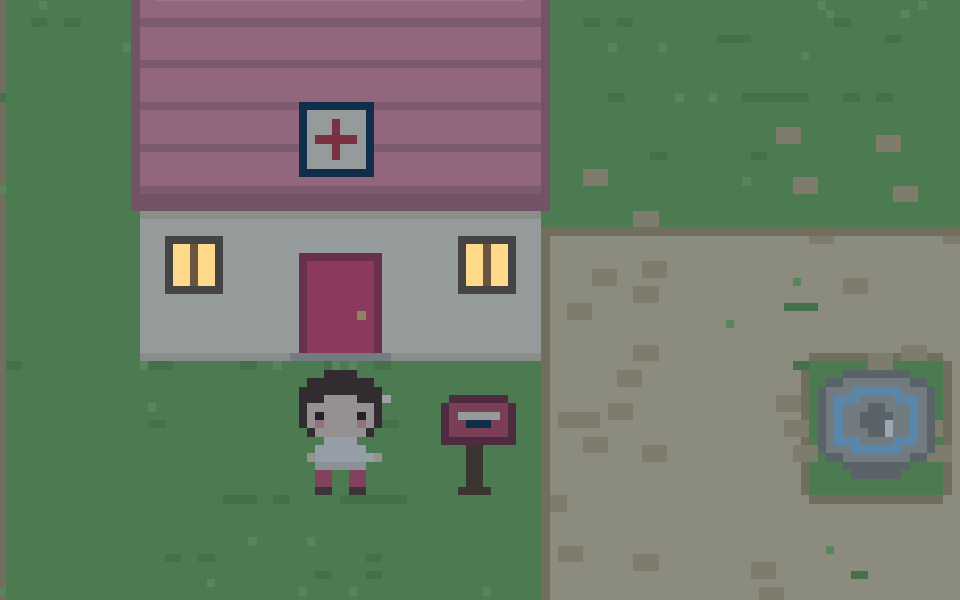
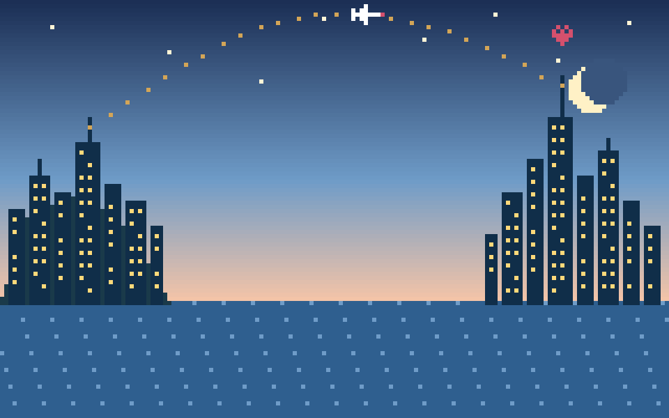
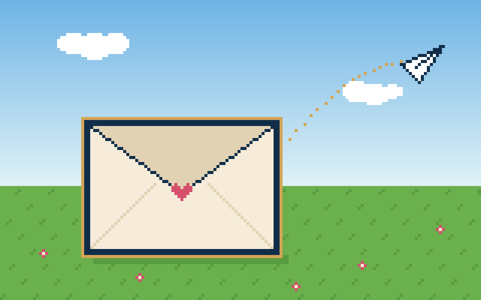
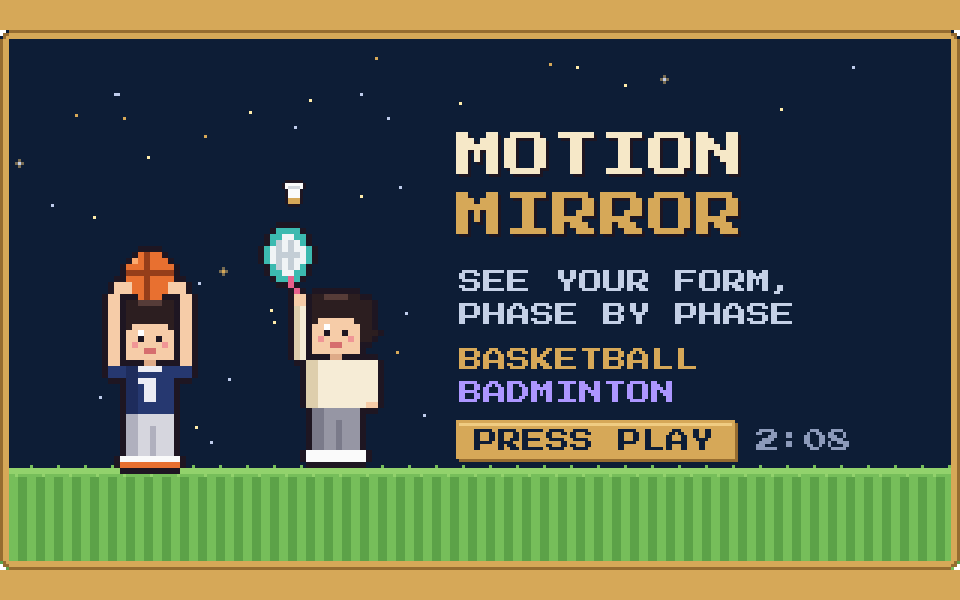
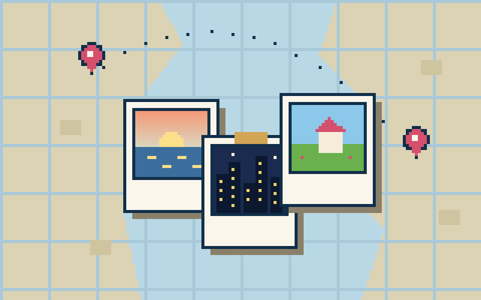

<p align="center">
  
</p>

<p align="center">
  
  
  
  
  
  
</p>

<p align="center">
  <b>A private, bilingual home for two.</b><br/>
  It began as a game: walk a small pixel version of yourself through a town<br/>
  where every house is a level made from something that happened to us.<br/>
  It has grown into everything we build for each other, under one domain.
</p>

<p align="center">
  
</p>

<p align="center">
  <sub>▶ <a href="https://youtu.be/C0-oPjvNzZk">Watch Yifan's full rehearsal run on YouTube</a> (静仪小镇，一见钟情). It plays the town through to the very end, so it spoils everything the README keeps quiet.</sub>
</p>

<p align="center">
  <sub>Yifan and Jingyi live thirteen hours and one Pacific Ocean apart, in College Station, Texas and Shenzhen, China.<br/>
  Built as a gift, and meant to keep growing. The name puns on 一见钟情, <i>love at first sight</i>: both names carry the syllable <i>Yi</i>, and the title borrows the 仪 from Jingyi's.</sub>
</p>

<br/>

## ◆ What Lives Here

`jingyifan.love` opens on a dashboard, one card per product. One password, known to the two of us,
stands in front of all of it.

<table>
  <tr>
    <td width="33%" valign="top"><a href="src/features/world/"></a><br/><b>Yi Town</b> · <code>/town</code><br/><sub>Nine doors, nine levels, a prologue and an epilogue. The game the rest grew from.</sub></td>
    <td width="33%" valign="top"><a href="src/features/clinic/"></a><br/><b>The Infirmary</b> · <code>/clinic</code><br/><sub>For the bad days: say what hurts, breathe three times, read the letter the other one wrote in advance.</sub></td>
    <td width="33%" valign="top"><a href="src/features/trip/"></a><br/><b>See You in New York</b> · <code>/trip</code><br/><sub>Jingyi's ticket for February 2027: both boarding passes, a countdown, and the itinerary a day at a time.</sub></td>
  </tr>
  <tr>
    <td valign="top"><a href="src/features/ask/"></a><br/><b>Ask Yifan</b> · <code>/ask</code><br/><sub>She writes what she needs and attaches files. It reaches his inbox, and the answer comes back by email.</sub></td>
    <td valign="top"><a href="https://rayford295.github.io/motionmirror/"></a><br/><b>MotionMirror</b> · <sub>off-site</sub><br/><sub>One phone video, every movement made clear: Rayford's jump shot and Jingyi's badminton.</sub></td>
    <td valign="top"><a href="src/features/photos/"></a><br/><b>Our Album</b> · <code>/photos</code><br/><sub>Both of us add photos; a model reads what is in each. Find them by words or days, or on a map of our trips.</sub></td>
  </tr>
</table>

The site exists in both languages and installs as an app that works offline. The town, the
infirmary and the trip run in the browser and keep everything on the device; the album keeps
its photos on a Worker behind a key of its own.

## ▶ How the Town Plays

```
  ┌──────────────────────────────────────────────────────────────┐
  │  ONE PASSWORD  →  DASHBOARD  →  WHO ARE YOU?  →  THE TOWN     │
  └──────────────────────────────────────────────────────────────┘
```

Pick who you are, then walk with the arrow keys, a tap on any tile, or the d-pad on a phone. Your
partner waits by the fountain and tells you how far they have got. The sky follows the clock in
your own city, so one of us walks it by day and the other by lamplight. Step onto a door and a
talk box tells that level's story; a cleared house flies a gold flag. Our cats, Coffee and Duoduo,
sit at the locked doors and tell you which level to clear first.

<details>
<summary><b>The nine houses</b></summary>
<br/>

| Roof | # | Level | The task |
|:---:|:---:|---|---|
| 🟥 | 1 | The Day We Met | Answer one question, then say the vow line out loud |
| 🟦 | 2 | Love Map | Name six street views; each right answer puts a heart on the map |
| 🟧 | 3 | Tattoo | Handwrite a tattoo for the other one and ink it |
| 🟩 | 4 | Moments | Put five memories in order, then put the other one's photo back together |
| 🟫 | 5 | Gomoku | Ten endgames, one stone each; the tenth completes a heart |
| 🟪 | 6 | Our Songs | Hear a passage, pick the title from four |
| ⬛ | 7 | Libra and Scorpius | Join the stars of both our signs |
| 🟥 | 8 | Us, in Old Verse | Put the missing characters of five love poems back |
| 🟨 | 9 | The Ring | Try it on with the camera and take a photo |

There is a short prologue before the first house, and there is more after the ninth. Neither is
written down here; the town tells you when you get there.

</details>

<details>
<summary><b>Around the square</b></summary>
<br/>

- **Rayford**, the guide, stands south of the fountain. He lists the levels, gives a hint, and can
  walk you to the next door. He never mentions the ring before it happens;
  `src/features/guide/secret.test.ts` enforces it.
- **Two signposts** lead out of the square: east to a day of Yifan's in College Station, west to a
  day of Jingyi's in Shenzhen, each a map of that person's stops by the hour.
- **A red mailbox** holds the voice notes the other one left, and **a jukebox** plays our songs.
- **Progress** lives on each phone; a short code or a link carries it to another device.

</details>

## ✉ From Her Message to His Answer

Ask Yifan is one of the two parts of the site with a back end (the other is the album, whose
Worker keeps the photos behind a key of its own: `worker/README.md`), and the one part that keeps
working while Yifan sleeps, thirteen hours behind her.

```
  her phone            Cloudflare            his Mac, every ten minutes
  ┌────────┐  POST   ┌──────────┐  email  ┌───────┐   ┌─────────────┐   ┌────────┐   ┌──────┐
  │  /ask  │ ──────▶ │  Worker  │ ──────▶ │ fetch │ ▶ │ local model │ ▶ │ Claude │ ▶ │ send │ ──▶ her inbox
  └────────┘         └──────────┘         └───────┘   └─────────────┘   └────────┘   └──────┘
   src/features/ask     worker/                              mailflow/
```

The page posts her text and files to a small Worker (`worker/`), which turns them into one email.
On Yifan's Mac, `mailflow/` collects each email into its own folder, has a local open model read
the screenshots and sort the request, hands the work to Claude, and emails the finished files
back to her. A message that fails Gmail's DKIM check, or asks for anything other than the work
itself, stops and waits for him.

Inbox addresses, local paths and her documents are kept out of this repository.

## ▤ What Is in the Repository

| Folder | What |
|---|---|
| [`src/`](src/) | The site. `core/` is shared; `features/` has one folder per feature, each with its own README |
| [`public/`](public/) | Photos, music, models and the dashboard cards, one folder per feature |
| [`worker/`](worker/) | Two Workers: Ask at `ask.jingyifan.love` (one email per request) and the album at `photos.jingyifan.love` (R2, D1, Workers AI) |
| [`mailflow/`](mailflow/) | The pipeline on Yifan's Mac that answers those emails (Python, Ollama, Claude) |
| [`scripts/`](scripts/) | Drawing scripts for the banner, the icons and the dashboard cards; small tools |
| [`ring/`](ring/) | The ring's Blender script and renders |
| [`paper/`](paper/) | The paper *MERIDIAN* ([arXiv:2610.41776](https://arxiv.org/abs/2610.41776)) and the Chinese report |
| [`docs/`](docs/) | Changelog, guide, deployment, design notes |

## ⌨ Develop

```bash
npm install
npm run dev       # http://localhost:5173
npm test          # 292 unit tests (Vitest)
npm run build     # strict type-check + production build
```

Vite · TypeScript · canvas 2D for the town (every tile and sprite is a string in `sprites.ts`
and `tiles.ts`; there are no image files for the game) · Leaflet · three.js · MediaPipe ·
Node 22. CI runs the tests and the build on every push.

<details>
<summary><b>More commands</b></summary>
<br/>

```bash
npm run banner       # redraw docs/banner.svg from the sprite data
npm run icon         # redraw favicon.svg and the PNG icons from the sprites
npm run ask:deploy   # deploy the Ask Worker (after npx wrangler login)
npm run photos:deploy   # deploy the album Worker (set-up steps in worker/README.md)
python3 mailflow/run.py   # one round of the mail flow; see mailflow/README.md for setup
```

</details>

## ⚑ More

- [docs/CHANGELOG.md](docs/CHANGELOG.md): what changed, by version
- [docs/GUIDE.md](docs/GUIDE.md): repository layout, everyday edits (add a memory, a word, a level), status, key dates, screenshots of every level
- [docs/DEPLOY.md](docs/DEPLOY.md): publishing, the Worker, the mail flow, private hosting
- Design notes: [the site](docs/superpowers/specs/2026-10-24-yi-at-first-sight-design.md) · [the game of levels](docs/superpowers/specs/2026-10-25-quest-design.md) · [the town](docs/superpowers/specs/2026-10-26-town-design.md) · [Ask Yifan](docs/superpowers/specs/2026-11-23-ask-design.md)
- [worker/README.md](worker/README.md) · [mailflow/README.md](mailflow/README.md): the two halves behind Ask Yifan

<p align="center">
  <sub>Live at <a href="https://jingyifan.love/">jingyifan.love</a>, unlisted. Code is MIT; the personal photos and messages here are ours, please do not redistribute (<a href="LICENSE">LICENSE</a>).</sub>
</p>

<p align="center">
  <sub>🐾 <b>Coffee</b>: ...Meow. This door is locked. Clear the one before it first.</sub>
</p>
